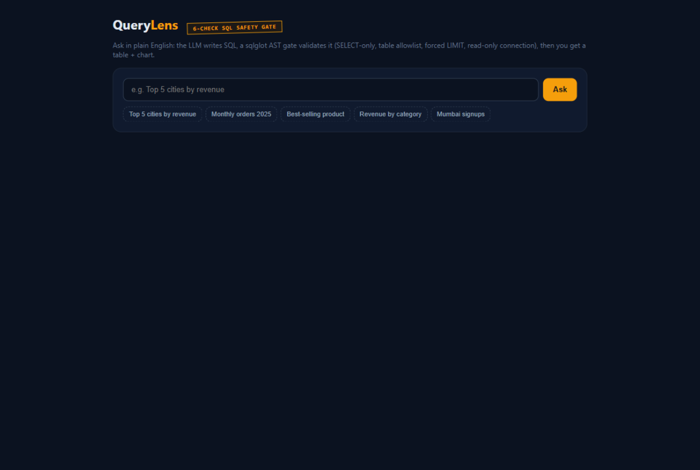

# QueryLens

[](https://fastapi.tiangolo.com) [](https://github.com/tobymao/sqlglot) [](https://chartjs.org)



*The dashboard: ask in English, the safety gate validates the SQL, results land in a table and chart.*

Ask questions about a database in plain English. The model writes the SQL, a validation layer checks it before anything runs, and you get the rows back as a table plus a bar chart.

The interesting part is not the SQL generation, it is what happens between the model and the database. Letting an LLM talk straight to a database is a bad idea, so every query passes through a gate before execution.

## The gate

Six checks, in order:

1. The SQL must parse (sqlglot, sqlite dialect).
2. Exactly one statement. Semicolon-chained statements are rejected.
3. The AST must be a SELECT. INSERT, UPDATE, DELETE, DROP, CREATE, ALTER, ATTACH, PRAGMA and GRANT are rejected anywhere in the tree, not just at the top level.
4. Every table in the query must be one of the four known business tables. This blocks `sqlite_master` snooping.
5. A LIMIT is always present and capped at 100, so a query cannot dump or scan the whole database.
6. Any query containing a `--` or `/*` comment is rejected outright, because comments are how injection payloads hide. A small function blacklist (`loadfile`, `readfile`, etc.) runs on the AST too.

On top of the gate, queries execute through a connection opened with `mode=ro` and `PRAGMA query_only = ON`. The gate is not the only thing standing between the model and your data, it is the second thing.

One lesson from testing this: the comment check has to run before anything else touches the SQL. My first version stripped comments before validating, which silently turned `SELECT * FROM customers -- ); DROP TABLE x` into a harmless SELECT that passed the gate. Neutralizing an attack and rejecting it are not the same thing, and only one of them is inspectable.

## Running it

```
python -m venv .venv
.venv/Scripts/pip install -r requirements.txt
cp .env.example .env    # set OPENAI_API_KEY
.venv/Scripts/python -m uvicorn app.main:app --reload
```

Open http://localhost:8000. The sample database (40 customers, 15 products, 120 orders, 250 order items, seeded deterministically) builds itself on first run.

## The eval

```
.venv/Scripts/python evals/run_eval.py --offline   # safety gate only, no API key
.venv/Scripts/python evals/run_eval.py             # execution accuracy vs golden SQL
```

The offline mode throws 12 deliberately malicious queries at the gate (drops, inserts, pragma, chained statements, comment smuggling, unknown tables) and currently blocks all 12 while passing a legitimate join query. Full mode compares result sets of generated SQL against 20 hand-written golden queries.

## Next steps

- PostgreSQL instead of SQLite, so it works against a real analytics DB.
- Cache identical questions instead of paying for the model twice.
- Follow-up questions with conversation context ("now break that down by month").
"# text-to-sql" 
