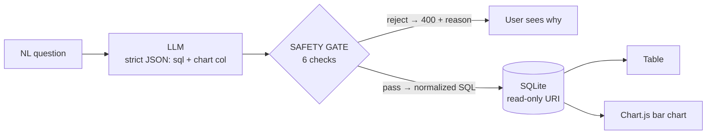

# QueryLens — Text-to-SQL with a 6-Check Safety Gate

Ask questions in plain English → the LLM writes SQL → **a sqlglot AST safety gate validates it** → a read-only SQLite connection executes it → results render as a table + bar chart. The safety engineering is what makes this project stand out in interviews.

## The safety gate (interview gold)

| # | Check | Why |
|---|---|---|
| 1 | **Parse** (sqlite dialect) | reject anything the parser can't understand |
| 2 | **Single statement** | block `SELECT 1; DROP TABLE x` chaining |
| 3 | **SELECT-only AST** | walk the tree; reject INSERT/UPDATE/DELETE/DROP/CREATE/ALTER/ATTACH/PRAGMA/GRANT anywhere |
| 4 | **Table allowlist** | only the 4 known business tables; blocks `sqlite_master` snooping |
| 5 | **Forced LIMIT ≤ 100** | no runaway queries, no full-table exfiltration |
| 6 | **Comment rejection + function blacklist** | any SQL containing `--` or `/*` is rejected outright; `loadfile`/`readfile` etc. blocked |

On top of the gate: queries run through a **read-only connection** (`file:...?mode=ro` + `PRAGMA query_only = ON`) — defense in depth.

## Architecture



## Run it

```bash
python -m venv .venv
.venv/Scripts/pip install -r requirements.txt
cp .env.example .env                     # set OPENAI_API_KEY
.venv/Scripts/python -m uvicorn app.main:app --reload
# open http://localhost:8000
```

The sample e-commerce DB (40 customers, 15 products, 120 orders, 250 order items, seeded deterministically) builds itself on first run.

## Evals

```bash
# zero API key — proves the gate blocks 12 malicious SQL attempts:
.venv/Scripts/python evals/run_eval.py --offline
# full: execution accuracy vs 20 golden SQL results (needs .env):
.venv/Scripts/python evals/run_eval.py
```

## Resume bullet

> Built a text-to-SQL analytics dashboard with a 6-check SQL safety gate (sqlglot AST validation, table allowlist, forced LIMIT, read-only connections) — blocked 12/12 malicious SQL attempts in an offline eval; X% execution accuracy on a 20-question benchmark.

## Roadmap

- [ ] PostgreSQL + real analytics DB instead of SQLite
- [ ] Query result caching + cost guardrails
- [ ] Streaming SQL generation with per-clause validation
- [ ] Follow-up questions ("now break that down by month") with conversation context
